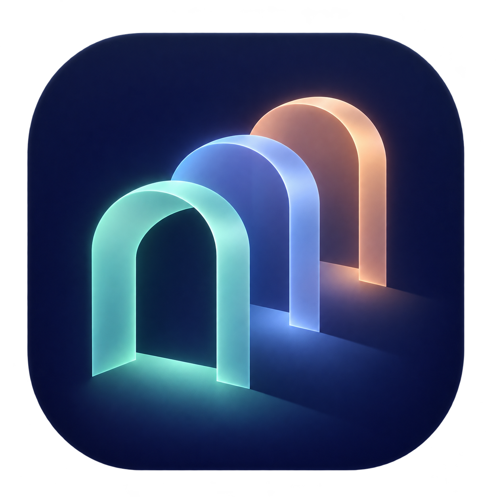
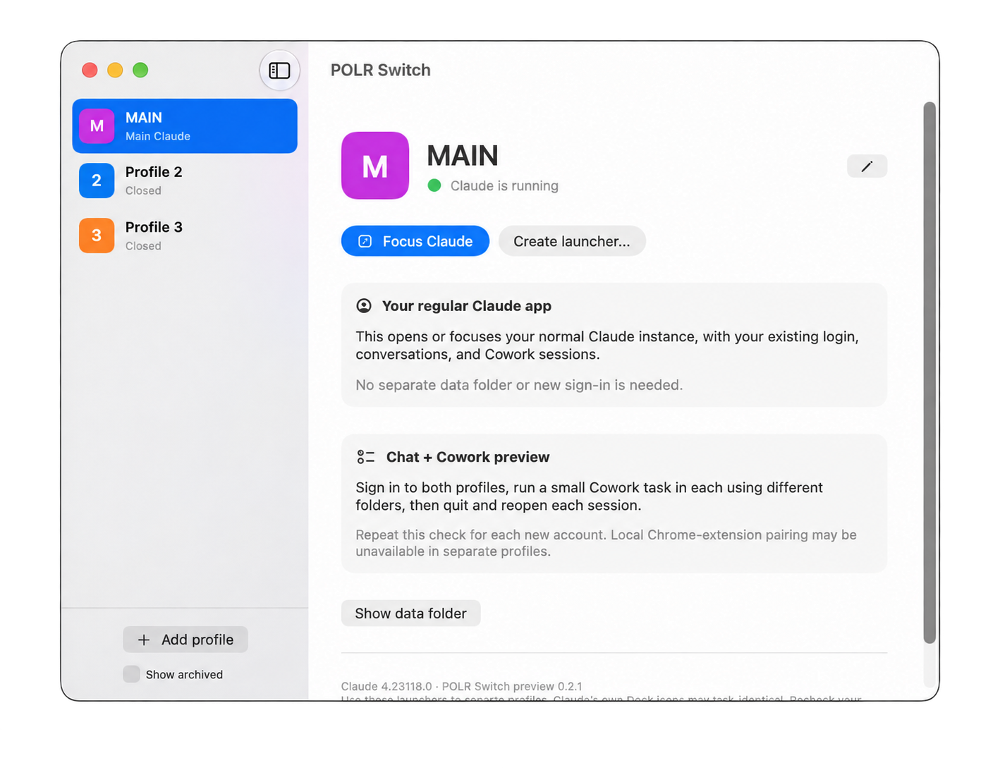

<a href="https://www.producthunt.com/products/polr-switch?embed=true&amp;utm_source=badge-featured&amp;utm_medium=badge&amp;utm_campaign=badge-polr-switch-claude-switcher" target="_blank" rel="noopener noreferrer"></a>

<p align="center"></p>
<h1 align="center">POLR Switch</h1>
<p align="center">A little room for every account.</p>

A native Mac launcher for keeping multiple Claude Desktop accounts organized. Your **Personal / Main** profile opens the normal installed Claude app with your existing login. Additional profiles open separate desktop data directories through their own unchanged, signed copies of Claude.

**v0.2.2 Preview · Apple Silicon · macOS 15+ · SwiftUI · No third-party dependencies**

POLR Switch is an independent project. It is not affiliated with or endorsed by Anthropic. Claude is a product of Anthropic. No Claude application code or binaries are distributed in this repository.

<p align="center"></p>
<p align="center"><sub>Example profile names shown for privacy.</sub></p>

## What's new in v0.2.2

- A refreshed native interface with a cleaner sidebar, clearer actions, and refined profile cards.
- Profile-colored icons for running Claude instances, making accounts easier to tell apart in the Dock. Main keeps the standard Claude icon.
- Green sidebar indicators show which profiles are running.
- A profile editor that opens with the saved name and color already filled in.

Existing profile data and logins are preserved. Quit and reopen a profile after changing its name or color to refresh its running icon.

## What it does

- Open or focus your usual Claude account without creating a new Main profile.
- Keep additional accounts signed in through named profiles.
- Create individual `.app` launchers with colored initials for your Dock. Separate running Claude profiles use the same color and initial; Main keeps the original Claude icon.
- Rename profiles without moving their data or changing their stable IDs.
- Archive and restore profiles without deleting their data.
- Switch profiles from the window or menu bar.

POLR Switch manages launch paths and profile data directories. It does not handle passwords, read your conversations, proxy requests, rotate accounts, or run its own AI service.

## Download and install

Version **0.2.2** is available as a ready-to-use Mac download, including the refreshed interface and profile-colored running icons.

[Download POLR Switch for Apple Silicon](https://github.com/polrai-bg/polr-switch/releases/download/v0.2.2/POLR-Switch-0.2.2-macOS-arm64.zip) or view the [release notes and checksum](https://github.com/polrai-bg/polr-switch/releases/tag/v0.2.2).

Unzip, drag **POLR Switch.app** into Applications, and open it. You need macOS 15 or later and Claude Desktop installed. No build tools are needed to use this download.

This preview is ad-hoc signed and **not notarized by Apple**. macOS may block the first launch. Read the [installation guide](docs/INSTALL.md) for Apple's documented first-launch process and the preview's limitations. Intel Macs are not supported by this download.

## Build from source

You need Apple Silicon, macOS 15 or later, Apple's Swift command-line tools with a macOS 15+ SDK, and Claude Desktop installed at `/Applications/Claude.app`. A recent full Xcode installation also supplies the tools, but an Xcode project is not required. The app uses APFS copy-on-write cloning for its local Claude copies. It applies native macOS custom-icon metadata to those copies without modifying their signed Contents or re-signing Claude. This Finder metadata makes a whole-bundle `codesign --verify --strict` check report resource-fork/Finder-info detritus; pristine copies are verified before the icon is applied.

```sh
git clone https://github.com/polrai-bg/polr-switch.git
cd polr-switch
bash build.sh
open "dist/POLR Switch.app"
```

The build runs the core tests, creates every macOS icon size, and ad-hoc signs `dist/POLR Switch.app`. You can move that app into your Applications folder. It is a local build, not a notarized download.

The script uses your selected macOS SDK. If the command-line tools include macOS 26.5, it prefers that SDK because the 27.0 command-line SDK tested during development omitted a SwiftUI macro plugin. Set `MACOSX_SDK_PATH` to override the SDK. Build output stays in ignored `.build/` and `dist/` directories.

## First use

1. Open Personal to focus your existing Claude account.
2. Open Work, or add a named profile, and sign in to the additional account.
3. Check the account displayed inside each Claude window. Email-code sign-in can avoid browser callback confusion when available.
4. Use **Create launcher** to save a named app in your Applications folder. Pin that generated launcher to your Dock.
5. Try a small Chat or Cowork task in each account using separate scratch folders before using real work files.

Separate running Claude profiles use their profile color and initial in the Dock. Quit and reopen a profile through POLR Switch after changing its name or color. Main keeps the original Claude icon. Window names can still be identical. Pin the generated launcher, not the running Claude copy. Opening a runtime copy directly omits the profile argument. POLR Switch checks process arguments and refuses a mismatched running copy, but it cannot verify which account you signed into.

## How it works

Main opens `/Applications/Claude.app` with no data-directory override. Each additional profile uses an unmodified, signature-verified APFS clone of the installed app and a unique `--user-data-dir` argument. Native Launch Services opens the exact app URL with application substitution disabled. Repeated opens reuse the intended process.

A closed profile copy is refreshed when its version differs from the installed Claude version. Active copies are not replaced. A previous copy is retained during replacement. This is version synchronization, not a guarantee that future Claude releases support the same behavior.

Registry writes are atomic and protected by a short lock. A separate per-profile lock coordinates launch, app-copy preparation, and archive operations across the manager and generated launchers. Copying, icon generation, and signing await subprocess completion without blocking the UI. Storage directories use private permissions. Names never become storage paths, and symbolic links are rejected at storage boundaries.

### Existing preview users

The app's storage directory and bundle identifier retain their original names to preserve existing accounts and generated launchers:

```text
~/Library/Application Support/Claude Profiles/
  profiles.json
  profiles/<UUID>/desktop/
  apps/<UUID>/Claude.app
```

Renaming the app to POLR Switch does not move profiles, sign you out, or change archive choices. Main still uses Claude's original storage. Recreate launchers made by older previews using POLR Switch to gain the new cross-process launch coordination. Older wrappers remain compatible with account storage, but their old code cannot participate in the new lifecycle lock.

Archiving, removing a launcher, or removing POLR Switch does not delete account data. No permanent-deletion feature is included.

## Tested and limited

Core checks cover registry integrity, stable IDs, migration, generic defaults, name validation, archive/restore, corrupt-file protection, process matching, argument parsing, locks, and symlink rejection.

Live checks with Claude 4.23118.0 verified distinct profile processes, launch reuse, quit/relaunch, and Main reusing the original Claude instance. Two signed-in accounts completed synthetic file tasks in separate folders with correct profile markers and sums. Their timed execution intervals overlapped by about 17 seconds. The additional account retained its login and task after an app restart and successfully wrote a matching continuation result.

Those tasks used Claude's current cloud-backed desktop workflows and wrote results back to selected Mac folders. One task explicitly fell back to its cloud workspace while the local Linux environment downloaded. This is **not** validation of independent local Cowork virtual machines. See [validation notes](docs/validation.md).

Known limits:

- Separate profiles are not an OS security boundary. They run as the same Mac user and may share machine resources.
- OAuth callbacks may return to a different open Claude window.
- The inspected Claude build disables local Chrome-extension pairing when its data directory is relocated. Other browser and MCP connection paths are unverified.
- A real Claude update and updater-triggered restarts have not been tested. Reopen through POLR Switch and recheck the account after updates.
- Intel Macs, notarized distribution, and long-running multi-account stress tests are not covered.

## Development

The source is intentionally small:

| File | Purpose |
| --- | --- |
| `Core.swift` | Profile registry, storage, migration, and process arguments |
| `Platform.swift` | Native launch/focus behavior and named launcher generation |
| `App.swift` | SwiftUI window, menu bar, editor, and launcher entry point |
| `Tests.swift` | Core checks, run by the build |
| `IntegrationTests.swift` | Optional live tests against installed Claude |
| `AppMetadata.swift` and `Info.plist` | Shared manager and generated-launcher identity |
| `LocalTool.swift` | Asynchronous local subprocess completion |
| `build.sh` | Build, test, icon packaging, and local signing |
| `release.sh` | ZIP creation, extraction/signature comparison, and SHA-256 checksum |

The optional integration test creates fresh anonymous test profiles in a uniquely named temporary directory. It opens and normally closes those test apps, leaves their folders for inspection, and does not sign in or run Cowork. Run it only when you are ready for test Claude windows to open:

```sh
SDK="$(xcrun --sdk macosx --show-sdk-path)"
xcrun swiftc -swift-version 5 -sdk "$SDK" -module-cache-path .build/module-cache \
  -target arm64-apple-macosx15.0 -parse-as-library \
  Core.swift AppMetadata.swift LocalTool.swift Platform.swift IntegrationTests.swift -o .build/integration-tests
.build/integration-tests
```

GitHub Actions runs the build, regression checks, and archive verification on an Apple Silicon macOS runner. Live Claude integration checks remain opt-in because they open desktop applications.

To prepare a downloadable archive after building:

```sh
bash release.sh "dist/POLR Switch.app"
```

The script refuses to replace an existing archive and validates the extracted signature and files before writing its checksum. The [red-flag audit](docs/AUDIT.md) and [structural decision log](docs/DECISIONS.md) explain the release review.

Issues and small, focused pull requests are welcome. Never include profile storage, login data, chat contents, or client screenshots in a report.

## Design and provenance

POLR Switch has its own name, native interface, and original doorway icon. The icon was generated for this project using OpenAI image generation; its [design brief](assets/DESIGN.md) is included. The runtime launcher icons use simple colored initials.

The launcher uses native macOS APIs and Electron's profile data-directory support. See [Electron's app API](https://www.electronjs.org/docs/latest/api/app) for background on application data paths.

## License

[MIT](LICENSE). Third-party applications and trademarks remain their owners' property.
